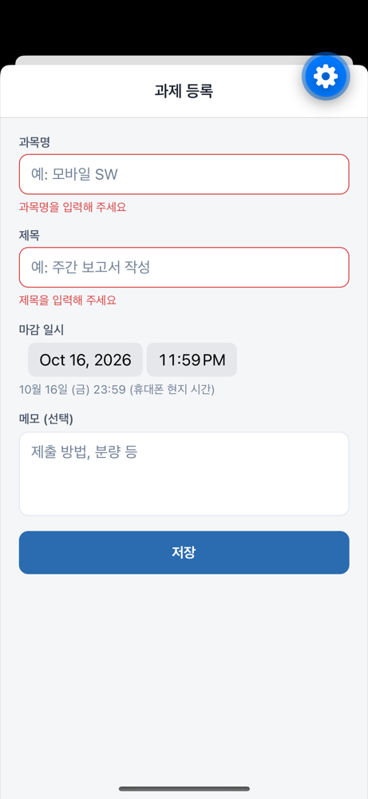
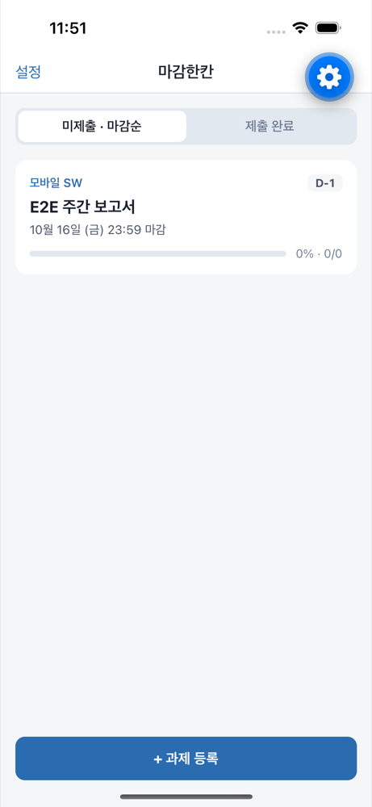
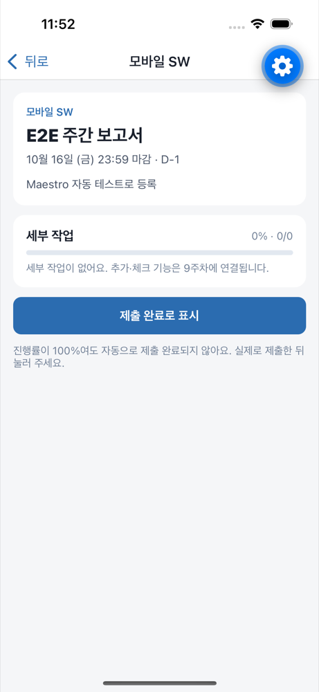
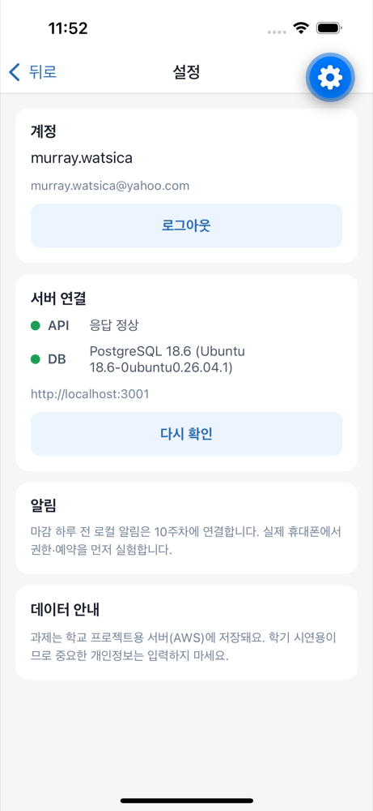

# 6주차(추정) 개발 기록 — 인증과 과제 핵심 화면

기간: 2026-10-15 · 작성자: 박초원 / AllaboutZENA · 도구: Claude Code 보조

수업 주차는 강의계획서 확인 전입니다. 2026-09-14를 2주차로 기록했으므로 이번 주를 6주차로 추정했습니다. 진행 상황은 4주차 범위에 머물러 있어, 이번 주에 W04 미결정 사항과 W05–W06 구현을 함께 진행했습니다.

## 이번 주 목표

- W04: 인증 방식 결정, 화면 흐름 확정
- W05: 과제 등록·조회 화면과 API 연결, 입력 검증·네트워크 오류 안내
- W06: 최소 인증, 소유자 접근 검사, 재실행 후 서버 데이터 조회
- 인프라: HTTPS 구성(#14)

## 실제 수행한 작업

| 작업 | 담당자 | Issue | PR·커밋 | 상태 |
| --- | --- | --- | --- | --- |
| 이메일·비밀번호 + DB 세션 토큰 인증 결정과 구현 | 박초원 | [#11](https://github.com/AllaboutZENA/msp-2026-one-step/issues/11) | [#15](https://github.com/AllaboutZENA/msp-2026-one-step/pull/15) | 완료 |
| 과제 CRUD API, 소유자 검사(타인 과제 404) | 박초원 | [#12](https://github.com/AllaboutZENA/msp-2026-one-step/issues/12) | [#15](https://github.com/AllaboutZENA/msp-2026-one-step/pull/15) | 완료 |
| 앱 로그인·홈·등록·상세·설정 화면 (Expo Router) | 박초원 | [#13](https://github.com/AllaboutZENA/msp-2026-one-step/issues/13) | 이 PR | 완료(시뮬레이터) |
| Maestro E2E 흐름 추가, 로컬·EC2에서 통과 | 박초원 | [#13](https://github.com/AllaboutZENA/msp-2026-one-step/issues/13) | 이 PR | 완료 |
| EC2 배포(마이그레이션 002) · 스모크 | 박초원 | — | [#15](https://github.com/AllaboutZENA/msp-2026-one-step/pull/15) | 완료 |
| Elastic IP·Nginx HTTPS·로그인 요청 제한 | 박초원 | [#14](https://github.com/AllaboutZENA/msp-2026-one-step/issues/14) | HTTPS PR | 완료(실기기 확인 전) |

## 확인과 배운 점

- 실행 환경·수행 절차: macOS, iPhone 16 시뮬레이터(iOS 18.3), Expo Go 57, 로컬 PostgreSQL 18과 EC2(시드니) PostgreSQL 18. API 자동 테스트 23개, 앱 E2E `apps/mobile/e2e/core-flow.yaml`.
- 실제 확인 결과와 증빙:

  | 필수값 안내 | 홈 목록 | 상세 | 설정(EC2 연결) |
  | --- | --- | --- | --- |
  |  |  |  |  |

- 이해한 핵심 코드·설계 이유: 소유자 검사는 SQL 조건(`user_id = $로그인 사용자`)에 넣어 라우트에서 빠뜨려도 새지 않게 했다. 토큰은 DB에 해시만 저장한다. 날짜는 ISO 8601(시간대 포함)로 보내고 화면은 기기 현지 시간으로 표시한다.
- 어려웠던 점과 해결:
  - E2E 중 발견: 날짜 선택기의 5분 단위 설정 때문에 화면은 23:55, 저장 값은 23:59로 달랐다 → 단위 제거.
  - 입력 오류 문구가 수정 후에도 남았다 → 해당 필드를 고치면 문구가 사라지도록 수정.
  - Expo Router `Link asChild`가 Pressable의 스타일 함수를 전달하지 않아 목록 카드 배경이 빠졌다 → `router.push`로 변경.
  - Expo Go의 개발자 메뉴 버튼이 헤더 오른쪽을 가려 설정 버튼을 왼쪽으로 옮겼다.
  - E2E 임의 이메일이 실제 도메인처럼 보여 `e2e-<시각>@example.com`으로 바꾸고 생성된 계정을 삭제했다.
- AI 등 도구 도움과 직접 수정·검증한 범위: 코드·문서·테스트는 Claude Code가 박초원의 요청 아래 작성·실행했고, 결과는 자동 테스트와 화면 증빙으로 확인했다. 팀원 개인 실습을 대신하지 않는다.

## 아직 못 한 것

- 실제 휴대폰 실행과 로컬 알림 실험(#5) — 휴대폰 필요
- 학생 3–5명 인터뷰(#3), 화면 스케치 팀 합의(#4)
- 수정·삭제 화면(W07), 세부 작업(W09)

## 다음 주 계획

- 실제 휴대폰으로 휴대폰 → HTTPS API → DB 확인 (8주차 중간 시연 준비)
- W07: 과제 수정·삭제 화면, 과목 필터
