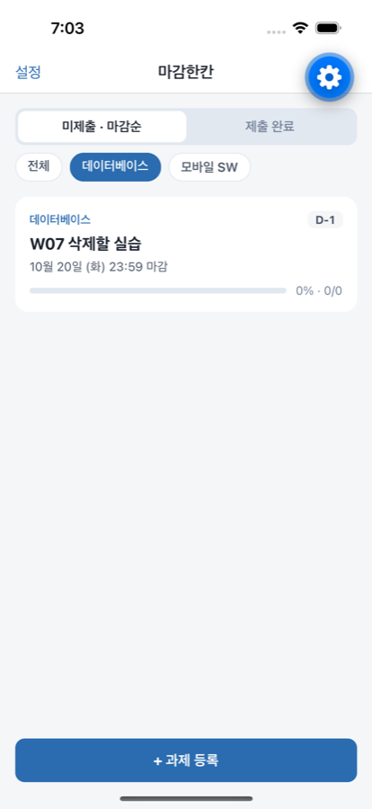
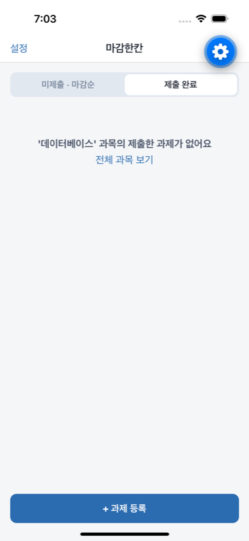
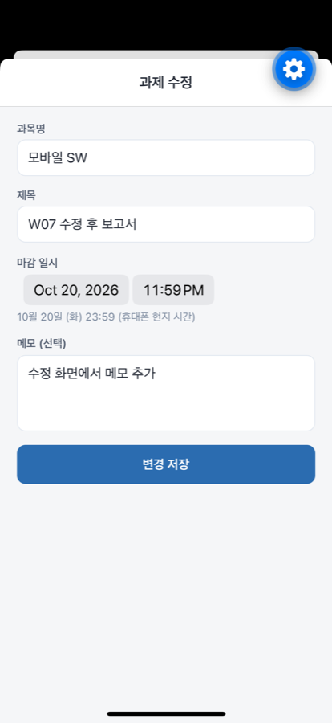
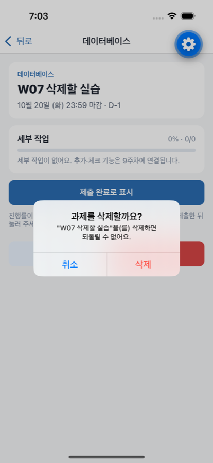
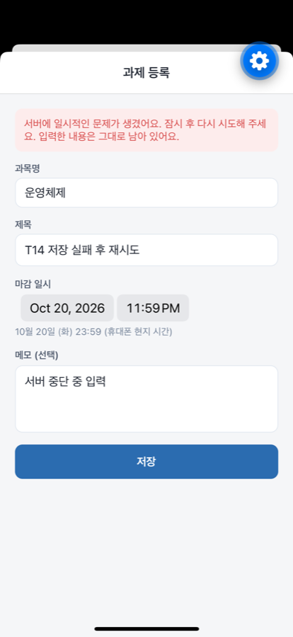

# 7주차(추정) 개발 기록: 과제 수정·삭제와 과목 필터

기간: 2026-10-19 · 작성자: 박초원 / AllaboutZENA · 도구: Claude Code 보조

수업 주차는 강의계획서 확인 전입니다. 2026-09-14를 2주차로 기록한 기준으로 이번 주를 7주차로 추정했습니다.

## 이번 주 목표

- W07: 등록 이후 관리 동작(수정·삭제)과 과목별 보기
- 저장 실패 경로(T14): 서버나 DB가 멈춘 상태에서 저장해도 성공처럼 보이지 않고 입력이 남는지

## 실제 수행한 작업

| 작업 | 담당자 | Issue | PR·커밋 | 상태 |
| --- | --- | --- | --- | --- |
| 등록·수정 공용 입력 폼(`AssignmentForm`), 과제 수정 화면 | 박초원 | [#18](https://github.com/AllaboutZENA/msp-2026-one-step/issues/18) | 이 PR | 완료(시뮬레이터) |
| 상세 화면 삭제 버튼 + 확인·취소 대화상자(세부 작업 개수 안내) | 박초원 | [#18](https://github.com/AllaboutZENA/msp-2026-one-step/issues/18) | 이 PR | 완료 |
| 홈 과목 필터 칩 · 필터 결과 빈 목록 안내 | 박초원 | [#18](https://github.com/AllaboutZENA/msp-2026-one-step/issues/18) | 이 PR | 완료 |
| API: DB 재시작 시 프로세스 종료 방지, 500 응답 한국어 안내 | 박초원 | [#18](https://github.com/AllaboutZENA/msp-2026-one-step/issues/18) | 이 PR | 완료 |
| E2E: `manage-flow.yaml`, `run-save-failure.sh`(T14) | 박초원 | [#18](https://github.com/AllaboutZENA/msp-2026-one-step/issues/18) | 이 PR | 완료 |
| 앱 ESLint(`eslint-config-expo`) 도입, 경고 정리 | 박초원 | — | 이 PR | 완료 |

## 확인과 배운 점

- 실행 환경·수행 절차: macOS, iPhone 16 시뮬레이터(iOS 18.3), Expo Go 57, 로컬 API·PostgreSQL 18. API 자동 테스트 25개, 앱 E2E 3종(`core-flow`, `manage-flow`, `run-save-failure.sh`).
- 실제 확인 결과와 증빙:

  | 과목 필터 | 필터 빈 목록 | 수정 화면 | 삭제 확인 |
  | --- | --- | --- | --- |
  |  |  |  |  |

  | 저장 실패: DB 중단 | 저장 실패: API 중단 |
  | --- | --- |
  |  |  |

- 이해한 핵심 코드·설계 이유:
  - 과목 필터는 휴대폰에서 적용한다. 목록이 이미 사용자별이고 작아서 서버 왕복이 필요 없고, 탭을 바꿔도 선택이 유지된다. 과목이 2개 이상일 때만 필터를 보여 준다.
  - 등록과 수정은 같은 폼을 쓰고 저장 동작만 부모 화면이 정한다. 실패하면 입력값을 그대로 두고, 연결 실패나 서버 오류(5xx)일 때는 "입력한 내용은 그대로 남아 있어요"를 붙인다.
  - 삭제는 되돌릴 수 없으므로 시스템 대화상자로 한 번 더 묻고, 세부 작업이 있으면 함께 삭제된다고 알린다. DB의 `ON DELETE CASCADE`가 실제 삭제를 맡는다.
- 어려웠던 점과 해결:
  - 다른 서버(EC2)에서 받은 세션이 남아 있으면 앱이 "로그인이 만료되었어요" 안내를 띄우고, 그만큼 내려간 가입 버튼을 키보드가 가렸다. E2E의 버튼 탭이 키보드에 떨어져 가입이 안 됐다. 비밀번호 칸의 키보드 완료 키로 바로 제출하게 했고, E2E는 버튼을 누르기 전에 키보드를 내린다. 같은 조건에서 3회 연속 통과했다.
  - API 연결 풀(pg Pool)에 오류 처리기가 없어서, PostgreSQL이 재시작되면 쉬고 있던 연결의 오류로 API 프로세스가 죽을 수 있었다. 처리기를 추가하고 DB 중단·재시작 E2E로 프로세스가 살아 있는지 확인했다.
  - 예상하지 못한 오류의 응답이 영어(`internal server error`)라 앱에 그대로 보였다. 내부 정보 없는 한국어 안내로 바꾸고 테스트를 추가했다.
  - Metro를 CI 모드로 띄우면 파일 감시가 꺼져 코드 수정이 앱에 반영되지 않는다. 수정 후 Metro를 재시작하고 E2E를 다시 실행했다.
- AI 등 도구 도움과 직접 수정·검증한 범위: 코드·문서·테스트는 Claude Code가 박초원의 요청 아래 작성하고 실행했으며, 결과는 자동 테스트와 화면 증빙으로 확인했다. 팀원 개인 실습을 대신하지 않는다.

## 아직 못 한 것

- 실제 휴대폰 실행(#14, #5): 휴대폰 필요
- 학생 인터뷰(#3), 화면 흐름 팀 합의(#4), 팀 정보·폼 제출(#6)
- 마감 일시 변경은 앱 E2E 대신 API 테스트로만 확인(날짜 선택기 자동 조작이 불안정)
- `expo-doctor`: Expo 패치 업데이트 2건, Xcode 26.4 이상 권장(Expo Go 실행에는 영향 없음, 개발 빌드 시 필요)

## 다음 주 계획 (8주차 중간 시연)

- EC2에 이번 변경 배포 후 HTTPS로 E2E 재실행
- 시연 시나리오: 휴대폰 → HTTPS API → PostgreSQL에서 등록 → 조회 → 수정 → 재실행
- 중간 시연본 `develop → master` PR
