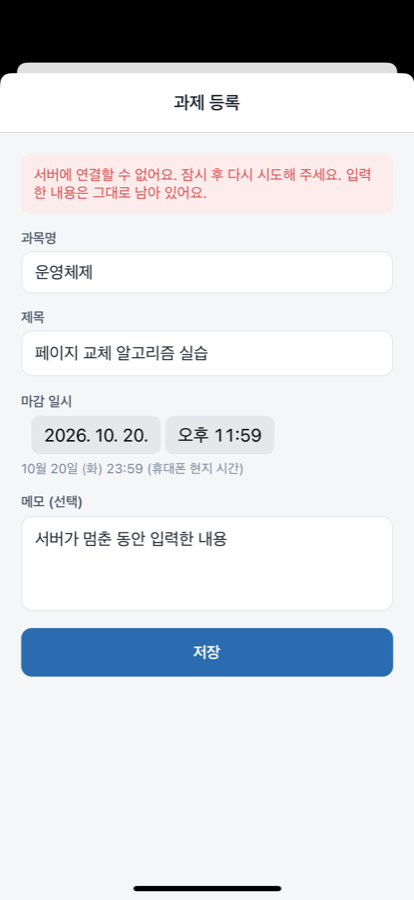
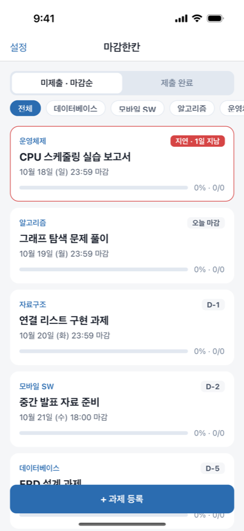

# 8주차(추정) 개발 기록: 중간 발표 준비

기간: 2026-10-19 · 작성자: 박초원 / AllaboutZENA · 도구: Claude Code 보조

수업 안내(Midterm Project Review)의 요구사항은 세 가지다. 실행 가능한 앱에서 핵심 기능 1개 이상을 시연하고, 발표 자료(PDF)·Git URL·실행 방법을 제출하며, 10–15분 동안 발표한다. 평가 비중은 정의·설계 25%, 동작 30%, 소스·과정 15%, 계획 10%, 기여·이해도 20%다.

## 실제 수행한 작업

| 작업 | 결과 |
| --- | --- |
| 발표 자료 8장 (소개 → 설계 → 시연 → 과정 → 문제 해결 → 계획) | 저장소 밖 제출 폴더에 PDF로 준비 |
| 시연 흐름 정리와 예비 영상 녹화 (시뮬레이터 → EC2 HTTPS) | 약 1분 30초, 로그인 → 등록 → 필터 → 수정 → 제출 → 삭제 → 재실행 |
| README를 중간 발표 기준으로 갱신 (상태, 빠른 실행, 기능 표, 팀) | 이 PR |
| 새 clone에서 README 실행 순서 확인 | 설치 → 마이그레이션 → 시드 → API → 데모 계정 로그인 통과 |
| 실제 서버 장애 확인: EC2 API 중지(502) 중 저장 | 안내·입력 유지, 재시작 후 재시도 저장 통과 |
| 안정본 develop → master, 태그 `v0.1.0-midterm` | 이 PR 이후 |

## 확인과 배운 점

| 서버(API) 중단 중 저장 | 시연 홈 화면 |
| --- | --- |
|  |  |

- EC2에서는 API가 멈추면 Nginx가 HTML 502를 돌려준다. 로컬과 달리 앱에 "요청 실패 (HTTP 502)"라는 기술적인 문구가 보였다. 502–504는 "서버에 연결할 수 없어요"로 바꾸고, 실제 서버를 멈춰 확인했다.
- 날짜 선택기는 Expo Go의 언어 설정을 따라 영어로 표시됐다. `locale="ko-KR"`로 한국어 표시를 고정했다.
- 데스크톱 폴더가 iCloud와 동기화되면서 ` 2` 사본 파일이 생겨 커밋에 섞였다. 발견한 사본은 삭제했다.

## 아직 못 한 것

- 실제 휴대폰 확인(#14), 팀원 역할 확정·팀 정보 제출(#6), 학생 인터뷰(#3)

## 다음 주 계획

- W09: 세부 작업 API와 화면, 진행률 표시
