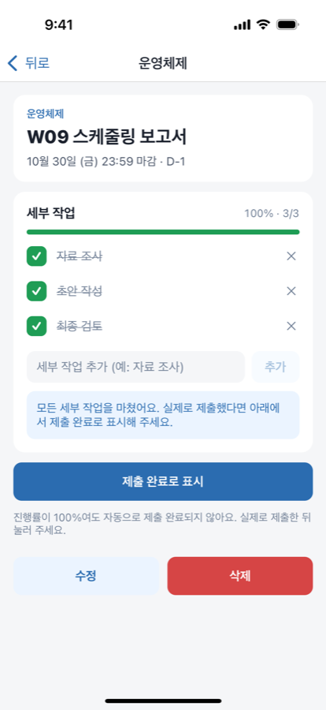
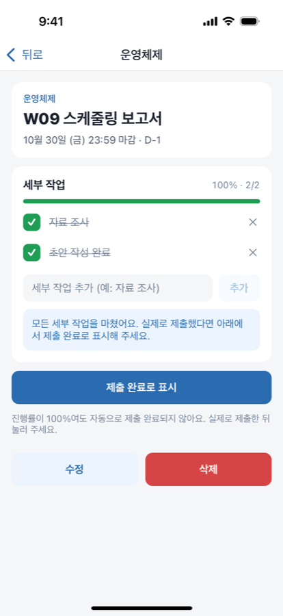

# 9주차(추정) 개발 기록: 세부 작업과 진행률

기간: 2026-10-29 · 작성자: 박초원 / AllaboutZENA · 도구: Claude Code 보조

중간 발표를 마쳤다. 이번 주에는 마일스톤 W09(세부 작업과 진행률, R03·R04)를 진행했다. 역할상 세부 작업 API는 Backend(서민호) 담당이지만, 이번 주에는 팀 결정에 따라 대표 계정에서 API와 화면을 함께 구현했다.

## 실제 수행한 작업

| 작업 | Issue | 상태 |
| --- | --- | --- |
| 세부 작업 API: 추가·이름 변경·완료 토글·삭제, 응답에 진행률 포함, 과제당 100개 제한 | [#29](https://github.com/AllaboutZENA/msp-2026-one-step/issues/29) | 완료 |
| 상세 화면 체크리스트: 즉시 체크(실패 시 되돌림), 연속 추가, 제목 눌러 이름 변경, 삭제 확인, 100% 안내 | [#30](https://github.com/AllaboutZENA/msp-2026-one-step/issues/30) | 완료(시뮬레이터) |
| 상세 화면 빨간 버튼 이름을 "과제 삭제"로 변경 | #30 | 완료 |
| E2E `subtasks-flow.yaml` 추가, 기존 흐름 회귀 확인 | #30 | 완료 |

## 확인과 배운 점

| 전부 완료(100%, 자동 제출 없음) | 이름 변경·삭제 후 |
| --- | --- |
|  |  |

- 진행률은 서버가 계산한 값만 화면에 쓴다. 변경 응답마다 `progress`를 돌려주므로 앱이 같은 계산식을 따로 두지 않는다. 체크박스만 먼저 바뀌고(낙관적 갱신), 요청이 실패하면 원래대로 돌린다.
- 소유자 검사는 과제 단위로 먼저 확인한 뒤 `subtasks.assignment_id` 조건을 함께 건다. 자기 과제 ID에 남의 세부 작업 ID를 섞어 보내도 404가 된다(테스트로 확인).
- 과제당 개수 제한은 `INSERT … SELECT … HAVING count(*) < 100` 한 문장으로 처리해, 확인과 추가 사이에 다른 요청이 끼어들 틈을 없앴다.
- E2E에서 세부 작업 삭제 확인을 누르면 대화상자 대신 뒤에 있는 빨간 "삭제" 버튼이 눌렸다. 상세 화면이 길어지면서 두 버튼이 모두 "제목 아래"에 놓였기 때문이다. 버튼 이름을 "과제 삭제"로 바꿔 대화상자의 "삭제"만 남게 했다. 세부 작업 ✕와 구분되어 사용자에게도 더 명확하다.

## 아직 못 한 것

- 실제 휴대폰 확인(#14), 학생 인터뷰(#3)
- 세부 작업 순서 바꾸기(현재는 추가 순서)

## 다음 주 계획 (W10)

- 마감 하루 전 로컬 알림(R07): 개발 빌드 필요 여부 확인(Expo Go의 알림 제약), 권한 거부·수정·삭제·제출 시 예약 처리
