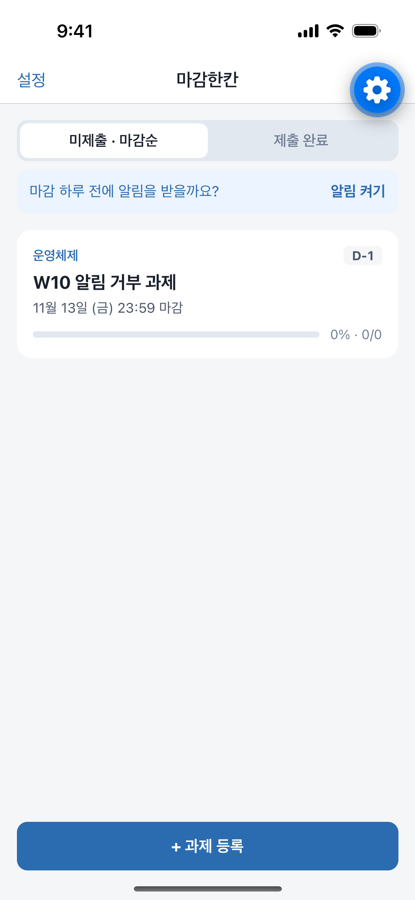
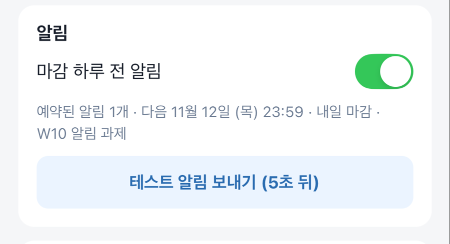
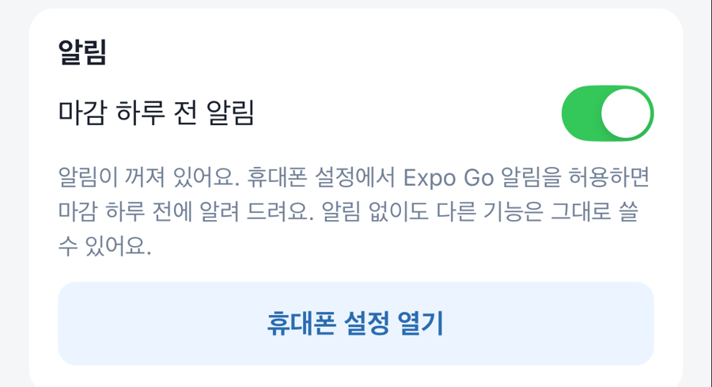

# 10주차(추정) 개발 기록: 마감 하루 전 로컬 알림

기간: 2026-11-12 · 작성자: 박초원 / AllaboutZENA · 도구: Claude Code 보조

마일스톤 W10의 남은 항목(R07 로컬 알림, Test-Plan T09–T12)을 진행했다. `expo-notifications`는 Expo Go(SDK 58)에서도 로컬 알림을 지원한다(원격 푸시만 개발 빌드 필요). 그래서 별도 빌드 없이 진행했다.

## 실제 수행한 작업

| 작업 | Issue | 상태 |
| --- | --- | --- |
| 예약 계획 순수 함수 `reminderPlan.ts`와 단위 테스트(앱에 vitest 도입) | [#36](https://github.com/AllaboutZENA/msp-2026-one-step/issues/36) | 완료 |
| 홈을 불러올 때 예약 동기화, 처음 한 번 "알림 켜기" 안내, 예약 실패 안내 | #36 | 완료 |
| 설정: 알림 켜기/끄기, 권한 상태(거부 시 휴대폰 설정 안내), 예약 개수·다음 알림, 테스트 알림 | #36 | 완료 |
| 로그아웃·세션 만료 시 예약 모두 취소, 알림을 누르면 과제 상세 열기 | #36 | 완료 |
| E2E `reminders-flow.yaml`·`reminders-deny.yaml` | #36 | 완료(시뮬레이터) |

## 확인과 배운 점

| 처음 안내 | 예약됨 | 권한 거부 |
| --- | --- | --- |
|  |  |  |

- 예약 ID를 `due-<과제 id>`로 고정해서 기기에 따로 저장할 값이 없다. 예약 내용에 알림 시각과 제목을 넣어 두고, 목록이 바뀌면 비교해서 바뀐 것만 다시 예약한다(T11).
- 알림 시각은 마감 24시간 전이다. 그 시각이 이미 지났으면 예약하지 않는다. 예를 들어 마감이 17시간 남은 과제는 예약하지 않는다(T10). "오늘 마감" 알림이 필요한지는 사용성 테스트에서 확인한다.
- 권한 요청은 앱을 켜자마자 하지 않는다. 미제출 과제가 생긴 뒤 홈에서 "마감 하루 전에 알림을 받을까요?"로 먼저 묻는다.
- E2E에서 배운 점:
  - iOS 알림 권한은 앱을 지우고 다시 설치해야 초기화된다. 시뮬레이터에서는 캐시된 Expo Go를 다시 설치해 거부 경로를 확인했다.
  - 새로 설치한 Expo Go는 개발자 메뉴 소개 화면을 띄우므로 공통 가입 흐름에서 닫는다.
  - 테스트 알림 배너가 화면 위의 "뒤로" 버튼을 가려 탭이 빗나갔다. 그래서 테스트 알림 단계를 흐름 끝으로 옮겼다.
- 설정 화면 캡처에는 서버 주소가 보여서 문서에는 알림 카드 부분만 잘라 넣었다.

- 실제 iPhone(iOS 26)에서 권한 허용 후 테스트 알림이 5초 뒤 도착하는 것을 확인했다(#36, #5).
- 같은 확인 중 iOS 26에서 홈의 탭·안내가 상단 제목줄과 겹치는 문제를 발견했다. SDK 58이 iOS 26에서 제목줄을 기본 투명(Liquid Glass)으로 바꿨기 때문이며, `headerTransparent: false`로 고쳤다(PR #39).

## 아직 못 한 것

- 알림 예약 실패를 일부러 일으켜 보는 확인(T12 나머지)
- 학생 인터뷰(#3)

## 다음 주 계획 (W11–13)

- 실제 iPhone 알림 수신 확인 후 #5 닫기
- 학생 3–5명 사용성 테스트(등록 → 세부 작업 3개 → 1개 완료 → 마감 확인)와 개선
